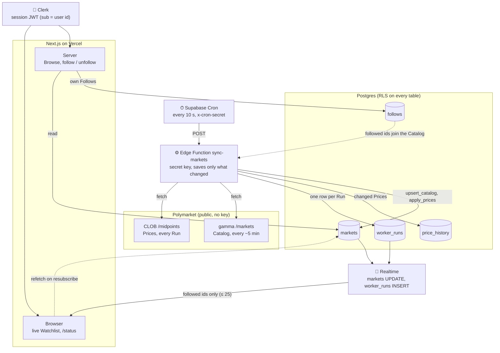
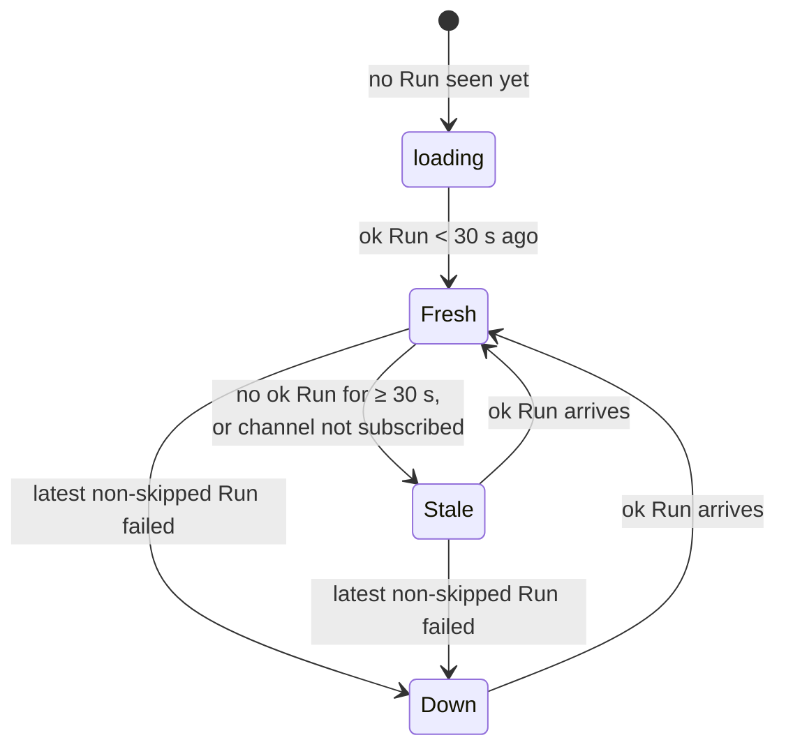

# Data flow — Odds Desk

How a Price gets from Polymarket to a user's screen. Drawn before any code (Assignment 5, step 3).

## What each hop sends

| From → To | Payload | Breaks if it changes |
|---|---|---|
| Cron → worker | Empty POST with `x-cron-secret` | Wrong/missing secret → every call rejected, no Runs → page goes **Stale** |
| gamma → worker | Array of Market objects; `outcomes`, `outcomePrices`, `clobTokenIds` are JSON **strings** | Field renamed or turned into a real array → `logic.ts` skips the Market (never half-writes); Catalog warning on `/status` |
| CLOB → worker | `{ token_id: "0.955" }` (string numbers) | Missing tokens → those Markets just don't move; values outside 0–1 are dropped; whole call fails → Run **failed** → page **Down** |
| worker → `markets` | `upsert_catalog`, `apply_prices` write only rows that are `is distinct from` the new values | Rewriting unchanged rows → Realtime flood, free quota burned |
| worker → `worker_runs` | started/finished, ok, skipped, rows_changed, warnings, error, duration | No row → Freshness can't tell Fresh from Stale |
| Realtime → browser | Changed `markets` row (new Price, `price_changed_at`), new `worker_runs` row | Table not published, no grant or no RLS policy → **silently nothing**; channel drop → **Stale**, refetch on resubscribe |
| Clerk → server/browser | JWT whose `sub` is the user id; `follows.user_id` defaults to it | Third-party auth not set up → requests run as `anon`, Follows fail; expired token not refreshed → Realtime stops after ~1 min |

## Freshness, from `worker_runs`

